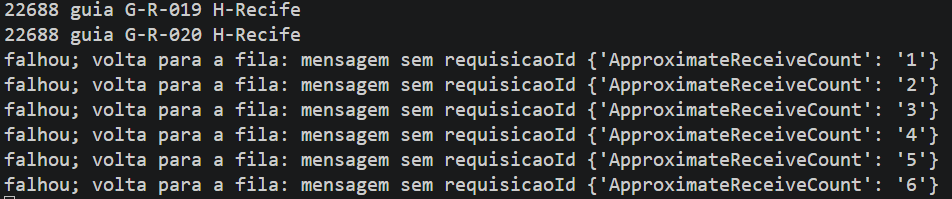
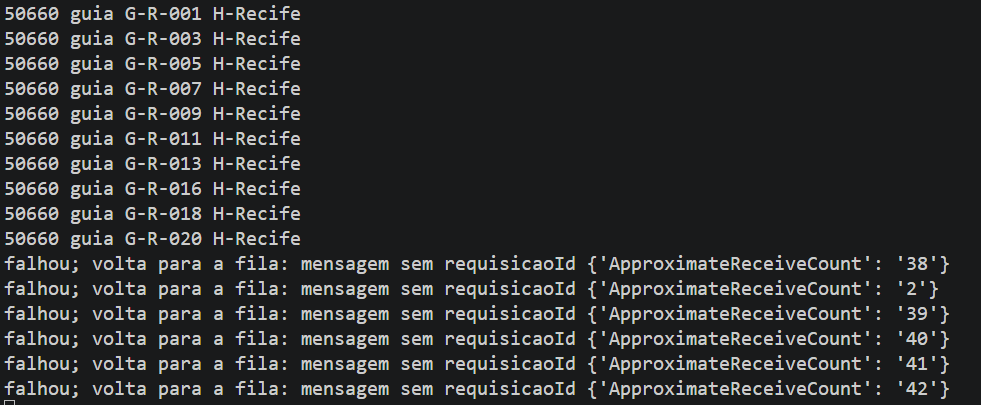
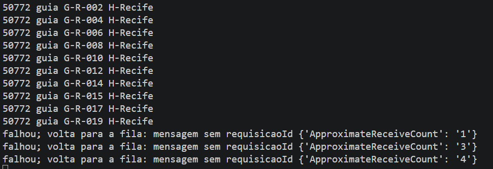

# Atividade Individual: Mensageria e Filas

## Como Rodar o Projeto
1. Certifique-se de ter o Docker, Python e AWS CLI instalados.
2. Suba o servidor ElasticMQ via Docker com o comando:
   `docker run -p 9324:9324 softwaremill/elasticmq-native`
3. Configure as credenciais locais e crie a fila:
   `aws sqs create-queue --queue-name guias --attributes VisibilityTimeout=15 --endpoint-url http://localhost:9324`
4. Em um terminal, inicie o consumidor: `python consumidor.py`
5. Em outro terminal, inicie o produtor: `python produtor.py`

## Caminho Escolhido
Caminho A: ElasticMQ local rodando no Docker.

---

## Demonstração em Vídeo
👉 [Clique aqui para assistir à demonstração no YouTube] https://youtu.be/vbSunUUP3ls

---

## Evidências dos Testes

### 1. Mensagem Inválida e Timeout
Comportamento da mensagem sem ID a entrar em loop de repetição pelo Visibility Timeout:

### 2. Balanceamento de Carga (Dois Consumidores)
Divisão das mensagens entre os dois terminais consumidores:
* **Consumidor 1:**
  
* **Consumidor 2:**
  

---

## Respostas das Perguntas

**1. Por que o consumidor só apaga a mensagem depois de processar? O que aconteceria se apagasse antes?**
O consumidor só apaga depois para garantir que o pedido foi realmente concluído. Se ele apagasse antes e desse algum erro no meio do caminho (como queda de energia ou falha no código), a mensagem seria perdida para sempre e o pedido nunca seria processado.

**2. Com dois consumidores, como as mensagens se dividiram? A ordem foi mantida? O que a documentação do SQS diz sobre ordem nas filas padrão?**
As mensagens foram divididas de forma alternada (balanceamento de carga) entre os dois consumidores. A ordem estrita não foi mantida perfeitamente, já que os dois puxam mensagens ao mesmo tempo. A documentação do SQS diz que filas do tipo Padrão (Standard) tentam preservar a ordem, mas não garantem a ordenação exata (para ordem 100% garantida, usa-se filas FIFO).

**3. A fila padrão garante entrega pelo menos uma vez, e a mesma mensagem pode chegar duas vezes. O que isso exige do consumidor? Como vocês o tornariam idempotente?**
Exige que o consumidor seja tolerante a repetições (idempotente). Para torná-lo idempotente, eu poderia checar em um banco de dados se aquele identificador já foi salvo antes de executar a ação. Se já existir, o consumidor simplesmente ignora a repetição e avisa a fila para apagar.

**4. Expliquem o visibility timeout com o que viram na mensagem inválida. Para que serve uma DLQ?**
O visibility timeout é o tempo que a mensagem fica "invisível" para outros consumidores enquanto está sendo processada (configuramos para 15 segundos). Como a mensagem inválida deu erro, ela não foi apagada pelo código. Passados os 15 segundos, ela voltou a ficar visível e o consumidor tentou processá-la de novo e de novo. Uma DLQ (Dead-Letter Queue) serve para resolver isso: ela isola mensagens com defeito após tentativas falhas, evitando que elas fiquem travando os consumidores em um loop infinito.

**5. Qual a diferença entre chamar a emissão diretamente (síncrono) e passar por uma fila (assíncrono)? O que se ganha e o que se perde?**
Chamando direto (síncrono), a origem precisa esperar o processador responder na hora; se o sistema cair, não é possível enviar o pedido. Usando a fila (assíncrono), a origem só joga o pedido lá e volta a trabalhar; se o sistema cair, a fila guarda o pedido em segurança até ele voltar ao ar. Ganha-se resiliência e estabilidade para não travar a aplicação, mas perde-se a resposta imediata de que a tarefa foi concluída naquele exato segundo.

## Uso de IA
- **Ferramenta:** Google Gemini
- **Finalidade:** Correção de erros de sintaxe nos códigos em Python fornecidos no roteiro e estruturação teórica sobre o funcionamento do SQS/ElasticMQ para o README.
- **Validação:** Os testes foram executados manualmente no VS Code utilizando terminais simultâneos e o resultado validado diretamente pelas saídas de log.
